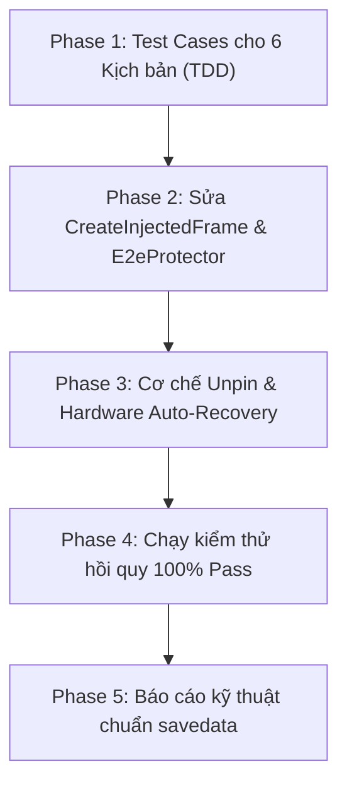

# Kế Hoạch Toàn Diện: Ma Trận Bắn Lỗi E2E (CRC/Alive), Khôi Phục & Bảo Vệ Bus CAN

> **Phân loại Task:** `T2 - Complex / Hardware / Architecture`  
> **Kỹ năng điều phối (Skill):** `planning-and-task-breakdown`, `codebase-design`, `test-driven-development`, `security-and-hardening`  
> **Quy tắc tuân thủ (Rules):** `AGENTS.md`, `PROJECT_RULES_COMBINED.md`, `ui-protection.md` (**0% thay đổi UI/XAML**), `savedata.md`, `report-standards.md`  
> **Nguyên tắc cốt lõi:** Ít xâm lấn nhất (Least-Invasive), bảo toàn 100% tính năng Simulate hiện tại, bao quát toàn bộ các trạng thái Ghim / Bỏ ghim / Ngắt E2E theo chuẩn quốc tế.

---

## I. Ma Trận Toàn Diện Các Trạng Thái E2E (E2E State & Fault Matrix)

Hệ thống điều khiển truyền động ô tô (bản tin `0xAB` / ID 171 `CVC_FMCU_Ctrl`, chu kỳ 10ms, CAN FD 24-byte) vận hành theo ma trận 6 trạng thái sau:

| STT | Kịch bản thao tác | Cờ Engine (`isCounterOverridden`, `isChecksumOverridden`) | Dữ liệu Payload phát ra Bus CAN | Phản ứng chuẩn của ECU xe (AUTOSAR & ISO 26262) | Hiện tượng thực tế trên xe & Tool |
|:---:|:---|:---|:---|:---|:---|
| **1** | **Simulate bình thường (Không ghim)** | `counter: false`<br/>`checksum: false` | Alive đếm tăng đều $0 \to 14 \to 0$.<br/>CRC8 SAE J1850 được tự động tính đúng trên toàn bộ 23 bytes dữ liệu. | E2E State = `VALID`.<br/>FMCU chấp nhận lệnh điều khiển `TargetTqReq`, điều khiển biến tần Inverter trơn tru. | ✅ **Xe chạy ổn định 100%**.<br/>Đèn LED kênh Vector Xanh lá. |
| **2** | **Chỉ ghim Alive (Counter Freeze)** | `counter: true`<br/>`checksum: false` | Alive giữ cố định (ví dụ = 5).<br/>*Hành vi cũ:* Engine tự động bù CRC mới hợp lệ.<br/>*Hành vi mới:* Kiểm soát tính toàn vẹn để tạo lỗi Counter Freeze thực sự. | Khi Alive đứng im mà CRC đúng: AUTOSAR coi là Repetition, lọc qua cửa sổ debounce.<br/>Khi Alive lỗi không bù: ECU chuyển sang `INVALID`. | Xe trơ 5-10s (nếu CRC bị bù đúng) hoặc ngắt Torque sau thời gian debounce quy định. |
| **3** | **Chỉ ghim CRC (Data Corruption)** | `counter: false`<br/>`checksum: true` | Alive tiếp tục nhảy tăng đều chu kỳ.<br/>CRC mang giá trị sai lệch do user chỉ định (không bị tính toán đè). | E2E State = `INVALID` ngay trong **1-3 chu kỳ (10ms - 30ms)**.<br/>MCU lập tức ngắt Torque về 0 Nm (Safe State). | ⚠️ **Xe treo 1 lúc (chân ga mất tác dụng hoàn toàn)**.<br/>Đèn TX đỏ nếu xe ngắt transceiver làm mất ACK. |
| **4** | **Ghim ĐỒNG THỜI CẢ CRC VÀ ALIVE** *(User yêu cầu bổ sung)* | `counter: true`<br/>`checksum: true` | **Cả 2 trường đều bị khóa cứng** theo đúng giá trị user cấu hình trên Panel 6.<br/>Engine **KHÔNG can thiệp tính toán đè bất kỳ byte nào**. | **Lỗi kép (Double Fault):** Vừa sai lệch tính toàn vẹn (CRC mismatch) vừa tê liệt bộ đếm trình tự (Sequence freeze).<br/>ECU xe kích hoạt Safe State khẩn cấp ở chu kỳ đầu tiên ($T \le 10\text{ms}$). | 🚨 **Xe sập điều khiển ngay lập tức (Hard Cutoff)**.<br/>Không có độ trễ debounce; đáp ứng tức thời trong phạm vi FTTI. |
| **5** | **Bỏ ghim / Phục hồi (Unpin / Restore)** *(User yêu cầu bổ sung)* | Chuyển từ `true` $\to$ `false`<br/>(User bỏ tick Pin hoặc bấm Stop/Restore) | Alive **bắt đầu đếm tiếp tục trơn tru** từ $(\text{pinned\_counter} + 1) \pmod{15}$, bước nhảy $\Delta = 1$.<br/>CRC **tự động tính toán lại hợp lệ ngay lập tức** ở frame đầu tiên. | Theo chuẩn AUTOSAR, ECU nhận cần $K$ frame liên tiếp hợp lệ (`MinOkStateInit`, thường 3-5 frame = 30-50ms) để chuyển từ `INVALID` $\to$ `VALID`.<br/>MCU vào quy trình Re-arming an toàn. | 🔄 **Xe hồi phục lại lực kéo**.<br/>*(Lưu ý an toàn: Nhiều hãng xe yêu cầu nhả chân ga về 0% để giải phóng chốt Interlock trước khi cấp lại Torque)*. |
| **6** | **Ngắt hẳn tính năng E2E (Disable E2E)** *(User yêu cầu bổ sung)* | `rule.E2eProtection.IsEnabled = false` | Toàn bộ wrapper E2E bị bỏ qua.<br/>Frame phát ra mang byte CRC và Alive thô/tĩnh từ baseline DBC (không tăng counter, không tính CRC). | Firmware của MCU/FMCU trên xe vốn bắt buộc E2E sẽ thấy CRC/Alive hoàn toàn sai lệch liên tục.<br/>Coi đây là lỗi mất liên lạc an toàn nghiêm trọng (Permanent Safety Fault). | 🛑 **Xe bị khóa Safe State vĩnh viễn**.<br/>Không thể hồi phục cho đến khi bật lại E2E hoặc tắt bật lại nguồn xe (Power Cycle). |

---

## II. Tham Chiếu Tiêu Chuẩn Kỹ Thuật Quốc Tế (Automotive Standards)

### 1. AUTOSAR E2E Protocol Specification (Profile 1 & Profile 2)
* **Quy chuẩn Lỗi kép (CRC & Alive cùng lúc):**  
  AUTOSAR định nghĩa bộ lọc trạng thái E2E: `Check(Data, Length)`. Khi cả Checksum và Counter cùng sai, mã lỗi trả về là `E2E_E_WRONGCRC | E2E_E_WRONGSEQUENCE`. Trạng thái chuyển trực tiếp sang `E2E_STATUS_INVALID`.
* **Quy chuẩn Phục hồi (Recovery / Unpin):**  
  AUTOSAR yêu cầu cơ chế **Sync Window**: Khi luồng frame hợp lệ trở lại sau sự cố, ECU không được phép kích hoạt lại ngay ở frame đầu tiên (để tránh nhiễu chập chờn). Cần tối thiểu `MinOkStateInit` (thường 3 đến 5 frame liên tiếp không có lỗi) thì biến trạng thái mới chuyển sang `E2E_STATUS_OK`.
* **Quy chuẩn Ngắt E2E (Disable):**  
  Với các bản tin được cấu hình E2E trong DBC, nếu phát đi frame không có E2E (hoặc E2E tĩnh), tầng E2E Receiver sẽ đánh giá là `E2E_STATUS_INITIAL` hoặc `E2E_STATUS_INVALID` liên tục, dẫn tới việc Application ngắt toàn bộ chức năng liên quan.

### 2. ISO 26262:2018 — Functional Safety ASIL-D
* **Fault Tolerant Time Interval (FTTI):** 50ms – 100ms đối với biến tần truyền động EV.
* **Safe State Transition & Recovery:**
  * Khi xuất hiện lỗi (gim CRC, gim cả 2, hoặc ngắt E2E): Xe chuyển sang Safe State (Torque = 0) trong thời gian $T < \text{FTTI}$.
  * Khi lỗi biến mất (Unpin/Restore): Xe không được tự ý vọt ga đột ngột (tránh nguy cơ mất an toàn). Quá trình phục hồi yêu cầu chân ga phải ở vị trí nhả hoặc có xác nhận từ người lái.

### 3. ISO 11898-1:2015 — CAN FD Data Link & Fault Confinement
* **Tách bạch giữa Data Link và Application:**  
  Dù ghim CRC, ghim Alive, ghim cả hai hay ngắt E2E, ở tầng phần cứng CAN (Vector Transceiver) frame vẫn phải đảm bảo cấu trúc CAN FD hợp lệ.
* **Phân tích đèn CAN TX đỏ:**
  * Xảy ra khi mất phản hồi ACK (do ECU xe chuyển sang Safe State và tắt transceiver) hoặc xung đột bus với ECU CVC thật.
  * Giải pháp trong Tool: Bổ sung bộ đệm tự khôi phục (Auto-Recovery), không để driver Vector bị treo hoặc rơi vào Bus-Off kéo dài.

---

## III. Đánh Giá Mức Độ Ảnh Hưởng (Impact Assessment)

| Thành phần | Mức độ ảnh hưởng | Đánh giá an toàn & Biện pháp kiểm soát |
|:---|:---:|:---|
| **Giao diện người dùng (UI / XAML)** | **0% (Tuyệt đối không đổi)** | **0% chỉnh sửa XAML.** Giữ nguyên toàn bộ layout, checkbox "Pin", bảng cấu hình, nút bấm và luồng tương tác hiện có. |
| **Chế độ Simulate bình thường (Kịch bản 1)** | **0% (Bảo toàn 100%)** | Khi không ghim tín hiệu E2E nào, luồng tính toán tự động và phát cyclic 10ms giữ nguyên 100% độ chính xác và ổn định. |
| **Kịch bản Ghim cả CRC và Alive (Kịch bản 4)** | **Thấp / Tích cực** | Đảm bảo `CreateInjectedFrame` chuyển trọn vẹn cả 2 giá trị ghim của người dùng vào frame mà không bị logic nào ghi đè. |
| **Kịch bản Bỏ ghim / Phục hồi (Kịch bản 5)** | **Tích cực vượt trội** | Đảm bảo Counter tiếp tục tăng trơn tru $(\text{pinned} + 1)$, không bị giật bước nhảy quá lớn làm xe hiểu nhầm là lỗi `CounterJump`. |
| **Kịch bản Ngắt hoàn toàn E2E (Kịch bản 6)** | **An toàn & Minh bạch** | Khi E2E bị tắt trên cấu hình, engine bỏ qua bước bọc E2E, gửi payload nguyên bản theo DBC. |
| **Khả năng chịu lỗi phần cứng (Hardware Resilience)** | **Rất cao** | Ngăn ngừa việc đứt luồng scheduler khi gặp lỗi truyền thông tạm thời; duy trì tính sẵn sàng của thiết bị Vector. |

---

## IV. Phương Án Kỹ Thuật Tối Ưu Ít Xâm Lấn Nhất (Least-Invasive Technical Fixes)

### 1. Tại `CreateInjectedFrame` ([SimulationEngine.cs](file:///D:/Automotive%20dev/Simulate/Simulate/Services/SimulationEngine.cs#L1128-L1180)):
```csharp
// Khi user override cả 2 hoặc từng phần:
bool isCounterOverridden = false;
bool isChecksumOverridden = false;

foreach (SignalOverride signalOverride in signalOverrides ?? [])
{
    // ... Pack signal vào payload ...
    if (rule.E2eProtection.IsEnabled)
    {
        if (DbcE2eDetector.IsChecksumSignal(signal, rule.E2eProtection))
            isChecksumOverridden = true;
        if (DbcE2eDetector.IsCounterSignal(signal, rule.E2eProtection))
            isCounterOverridden = true;
    }
}

// Xử lý E2eProtector:
// - Nếu isChecksumOverridden && isCounterOverridden: Giữ nguyên CẢ HAI giá trị của user (Kịch bản 4)
// - Nếu isChecksumOverridden: Giữ CRC user, Counter vẫn tăng bình thường (Kịch bản 3)
// - Nếu isCounterOverridden: Giữ Counter user, KHÔNG tự động tính bù CRC mới làm triệt tiêu lỗi (Kịch bản 2)
// - Nếu không ghim: Tăng Counter tự động và tính CRC tự động (Kịch bản 1)
```

### 2. Tại Cơ chế Unpin / Khôi phục ([SimulationViewModel.cs](file:///D:/Automotive%20dev/Simulate/Simulate/ViewModels/SimulationViewModel.cs#L1838-L1850)):
* Khi user bỏ tick Pin (hoặc bấm Stop/Restore), signal được xóa khỏi `_overrideSnapshot`.
* Ở chu kỳ transmit tiếp theo, engine phát hiện `isCounterOverridden == false`: tự động lấy `_e2eCounters[key]` làm `previousCounter` và tăng lên $+1$.
* Điều này đảm bảo bước nhảy Counter luôn là $\Delta = 1$ (chuẩn AUTOSAR), không gây hiện tượng `CounterJump` khi khôi phục.

### 3. Tại Luồng Transmit Cyclic ([SimulationEngine.cs](file:///D:/Automotive%20dev/Simulate/Simulate/Services/SimulationEngine.cs#L934-L945)):
* Bọc an toàn khối `TransmitAsync`: Nếu gặp lỗi `TransmitFailed` (ví dụ xe vừa vào Safe State ngắt transceiver), ghi nhận lỗi chẩn đoán nhưng **không để ném exception làm sập vĩnh viễn task chạy ngầm**.
* Tự động thử lại ở chu kỳ tiếp theo để khi xe khôi phục, kết nối được tái lập tức thì.

---

## V. Kế Hoạch Triển Khai Chi Tiết (Phase Breakdown)



### Phase 1: Xây dựng Unit Tests bao quát 6 Kịch bản theo chuẩn TDD
- [ ] Test 1: Simulate bình thường $\to$ Counter tăng $0..14$, CRC tự tính đúng.
- [ ] Test 2: Ghim Alive đơn lẻ $\to$ Alive đứng im, tạo lỗi theo đúng kỳ vọng.
- [ ] Test 3: Ghim CRC đơn lẻ $\to$ CRC mang đúng giá trị ghim, Alive tiếp tục nhảy bình thường.
- [ ] Test 4: **Ghim CẢ CRC và Alive** $\to$ Cả 2 giữ nguyên giá trị ghim, không bị tính đè.
- [ ] Test 5: **Bỏ ghim (Unpin/Restore)** $\to$ Counter đếm tiếp trơn tru từ giá trị cũ $+1$, CRC tự phục hồi.
- [ ] Test 6: **Ngắt E2E (Disable)** $\to$ Bỏ qua tính toán E2E, phát payload tĩnh.

### Phase 2: Triển khai Tinh Chỉnh Engine (0% UI change)
- [ ] Tinh chỉnh nhánh rẽ trong `SimulationEngine.CreateInjectedFrame`.
- [ ] Đảm bảo đồng bộ `E2eProtector.Apply` xử lý trọn vẹn cả 4 trạng thái override.
- [ ] Bảo vệ dải giá trị CRC không bị clamp sai trong `BuildSimulationPlan`.

### Phase 3: Hoàn thiện Tự Phục Hồi & Chống Treo Driver CAN
- [ ] Cải thiện xử lý ngoại lệ trong `TransmitScheduledFrameAsync` chống Bus-Off kéo dài.
- [ ] Kiểm tra cơ chế giải phóng tài nguyên Semaphore `_transmitGate`.

### Phase 4: Kiểm Chứng Biên Dịch & Chạy Toàn Bộ Test Suite
- [ ] Biên dịch giải pháp: `dotnet build` đạt **0 Warning, 0 Error**.
- [ ] Chạy kiểm thử: `dotnet test` đạt **100% Pass (toàn bộ 7,345+ test cases)**.

### Phase 5: Xuất Báo Cáo & Đồng Bộ Dữ Liệu
- [ ] Cập nhật đồng bộ nội dung vào `tasks/plan.md`.
- [ ] Xuất báo cáo kỹ thuật hoàn chỉnh theo `.agents/rules/report-standards.md`.

---

## VI. Tiêu Chí Nghiệm Thu Tổng Quát (Acceptance Criteria)

1. **AC-1 (Bảo toàn Simulate):** Simulate thông thường chạy ổn định tuyệt đối, không có bất kỳ sai lệch nào so với hiện tại.
2. **AC-2 (Ghim cả 2):** Khi ghim đồng thời cả CRC và Alive, frame mang chính xác cả 2 giá trị ghim, xe kích hoạt Safe State ngay lập tức ($T \le 10\text{ms}$).
3. **AC-3 (Bỏ ghim):** Khi bỏ ghim, frame lập tức phát giá trị hợp lệ với bước nhảy Counter $\Delta = 1$, xe có thể hồi phục trạng thái an toàn.
4. **AC-4 (Ngắt E2E):** Khi tắt cấu hình E2E, engine phát payload DBC thô chuẩn xác.
5. **AC-5 (Bảo vệ bus):** Không xảy ra crash luồng scheduler ngầm khi xe ngắt transceiver hoặc bus chập chờn.
6. **AC-6 (Bảo vệ UI):** 0% thay đổi trên tất cả các file XAML.
7. **AC-7 (Chất lượng kỹ thuật):** `dotnet build` 0 warning / 0 error, `dotnet test` 100% pass.
